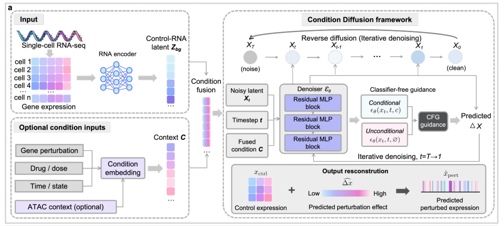

# Response-space state-transition modeling predicts cellular responses across perturbation contexts

**BaiZe** models perturbation-induced cellular state transitions using conditional diffusion. Given control-cell RNA expression and a perturbation context, it predicts an expression-change vector and reconstructs the post-perturbation state:

\[
\hat{x}_{\mathrm{pert}} = x_{\mathrm{ctrl}} + \widehat{\Delta x}.
\]

<p align="center">
  
</p>

The framework supports genetic and combinatorial perturbations, drug structure/dose, time-dependent state prediction and optional ATAC conditioning. Human-to-mouse transfer additionally uses an ortholog-aligned residual adaptation workflow.

## Installation and inputs

```bash
git clone https://github.com/simonzqw/BaiZe.git
cd BaiZe
conda create -n baize python=3.10 -y
conda activate baize
pip install torch scanpy anndata numpy scipy pandas scikit-learn matplotlib seaborn tqdm rdkit pyranges
```

Training inputs are processed AnnData `.h5ad` files. The gene order, normalization, control labels, covariates and train/validation/test split must match the chosen experiment. Where a predefined split exists, use `--split_strategy custom --split_col <column>`. Examples below use the **historical AutoDL layout**, not paths bundled with this repository. Replace paths with actual local data and checkpoints. The following scripts are the principal entry points:

| Component | Script |
|---|---|
| Conditional diffusion training | `train_diffusion.py` |
| Conditional diffusion evaluation | `evaluate_diffusion.py` |
| Single/multi-gene prediction | `predict_diffusion.py` |
| Cross-species residual training/inference | `scripts/cross_species_train_residual.py`, `scripts/cross_species_infer_residual.py` |

## 1. Genetic perturbation: Adamson UPR triple-gene holdout

**Task:** train with controls, single-gene and double-gene interventions; evaluate the held-out `ATF6+EIF2AK3+ERN1` triple perturbation. Input: 14,675 cells × 5,002 genes, with fixed `obs['split']`. The original dataset is Adamson Perturb-seq ([GSE90546](https://www.ncbi.nlm.nih.gov/geo/query/acc.cgi?acc=GSE90546)); use the documented processed h5ad for the recorded split.

```bash
DATA=/root/autodl-fs/triple_perturb/adamson_upr/processed/adamson_upr_triple_clean_split_hvg5000_log1p_dense.h5ad
OUT=adamson_upr_triple/checkpoints_hvg5000_dense_final

# Train
python train_diffusion.py \
  --data_path "$DATA" --save_dir "$OUT" \
  --split_strategy custom --split_col split \
  --perturb_parse_mode raw --background_key cell_line \
  --target_mode delta --epochs 50 --batch_size 256 \
  --timesteps 1000 --sample_steps 50 --val_sample_batches 3 \
  --patience 12 --control_match_scope global \
  --control_prototype_mode topk_weighted --control_match_k 32 \
  --cond_dropout 0.1 --lambda_topde 0.2 \
  --lambda_delta_corr 0.1 --lambda_centroid 0.1 --topde_k 50

# Evaluate the held-out triple perturbation
python evaluate_diffusion.py \
  --data_path "$DATA" --model_path "$OUT/best_model_diff.pth" \
  --output_json "$OUT/eval_triple_best_diff.json" \
  --split_strategy custom --split_col split \
  --perturb_parse_mode raw --background_key cell_line \
  --target_mode delta --sample_steps 50 --guidance_scale 1.0 \
  --control_match_scope global \
  --control_prototype_mode topk_weighted --control_match_k 32
```

**Note:** the historical primary evaluation additionally fixed `residual_sample_scale=0.0`. That flag must be supported by the checked-out evaluation source before claiming equivalence to the recorded result; verify with `python evaluate_diffusion.py --help`. See the experiment record for the full residual-scale sensitivity analysis. A separately packaged [Adamson reviewer smoke test](reviewer_demo/Adamson/README.md) provides a smaller demonstration; it does **not** reproduce the full benchmark.

## 2. Drug response: Sci-Plex

**Task:** predict drug- and dose-conditioned RNA changes for IID/random, held-out-drug and held-out-context × drug splits. Data source: [Sci-Plex / GSE139944](https://www.ncbi.nlm.nih.gov/geo/query/acc.cgi?acc=GSE139944). The examples assume preprocessed h5ad data with `smiles`, `dose`, `cell_context`, `is_control` and predefined split columns.

```bash
DATA=/root/autodl-fs/project3/data/Sci_Plex_drug_standardized.h5ad

# IID/random structure-conditioned training
python train_diffusion.py \
  --data_path "$DATA" --save_dir checkpoints_sciplex_random_structure \
  --task_mode drug --split_strategy custom --split_col split_random_std \
  --background_key cell_context --context_col cell_context \
  --perturb_col perturbation --smiles_col smiles --dose_col dose \
  --control_col is_control --drug_condition_mode structure \
  --target_mode delta --batch_size 4096 --preset vnext --amp

# Held-out-drug training: change the split and output directory
python train_diffusion.py \
  --data_path "$DATA" --save_dir checkpoints_sciplex_ood_structure \
  --task_mode drug --split_strategy custom --split_col split_ood_std \
  --background_key cell_context --context_col cell_context \
  --perturb_col perturbation --smiles_col smiles --dose_col dose \
  --control_col is_control --drug_condition_mode structure \
  --target_mode delta --batch_size 4096 --preset vnext --amp
```

For compound held-out cell-context × drug experiments, use `Sci_Plex_drug_crisp_like_splits.h5ad` and one of `split_crisp_k562_drugood_std`, `split_crisp_a549_drugood_std` or `split_crisp_mcf7_drugood_std`, with a different output directory for each run.

**Evaluation caution:** the currently tracked `scripts/evaluate_drug_response.py` is a **placeholder**, not a valid model-inference evaluator: it substitutes the observed response for predictions. **Do not run it to report drug performance.** Evaluation requires the verified server-side evaluator that actually loads `best_model_diff.pth` and generates test predictions (or an independently verified evaluator consuming saved, genuine `predictions_test.npz`). These evaluated assets and their provenance must be checked before reporting results.

## 3. Cross-species perturbation: human → mouse

**Task:** transfer ARID1A/PDCD1 effects from human CD8 T cells to mouse tumour-infiltrating T cells, using a one-to-one ortholog-aligned expression space. **This workflow trains a distinct residual-transfer model**, not the shared diffusion training script. Historical datasets: human [GSE119450](https://www.ncbi.nlm.nih.gov/geo/query/acc.cgi?acc=GSE119450), mouse RNA [GSE203592](https://www.ncbi.nlm.nih.gov/geo/query/acc.cgi?acc=GSE203592) and mouse ATAC [GSE203591](https://www.ncbi.nlm.nih.gov/geo/query/acc.cgi?acc=GSE203591).

```bash
V2=/root/autodl-fs/k_spices/processed/cross_species_v2
COMBINED=/root/autodl-fs/k_spices/processed/cross_species_human_train_mouse_test_atac_replicate256.h5ad
MOUSE=/root/autodl-fs/k_spices/processed/mouse_til_perturb_cross_available_strict_atac_replicate256.h5ad
VOCAB=/path/to/verified_perturb_vocab.txt

# Build source pseudobulk (from prepared, ortholog-aligned input)
python scripts/cross_species_build_pseudobulk.py \
  --data_path "$COMBINED" \
  --out_npz "$V2/cross_species_pseudobulk_bootstrap128_atac_controlatac_top20w10.npz" \
  --split_col split --train_split_value train \
  --species_col species --human_value human \
  --perturb_col perturbation --context_col cell_context \
  --control_key control --atac_key atac_feat --atac_source control \
  --bootstrap_reps 128 --sample_ctrl 256 --sample_pert 256 \
  --top_de_n 20 --top_de_weight 10

# Train residual-transfer model (reconstructed settings; check original checkpoint)
python scripts/cross_species_train_residual.py \
  --pseudobulk_npz "$V2/cross_species_pseudobulk_bootstrap128_atac_controlatac_top20w10.npz" \
  --save_dir checkpoints_cross_species_residual_REBUILT \
  --perturb_vocab_path "$VOCAB" --use_atac --learn_perturb_alpha \
  --rank 64 --hidden_dim 512 --residual_scale 0.01 \
  --epochs 100 --batch_size 64 --lr 3e-5 --seed 42

# Inference on target-species control backgrounds
python scripts/cross_species_infer_residual.py \
  --combined_h5ad "$COMBINED" --mouse_h5ad "$MOUSE" \
  --ckpt checkpoints_cross_species_residual_REBUILT/best_model_cross_species_residual.pth \
  --out_dir preds_cross_species_REBUILT \
  --perturbations ARID1A PDCD1 --atac_key atac_feat \
  --context_col cell_context --contextwise --aggregate_contexts

# All-gene global and context-wise evaluations (not manuscript Top20 metrics)
python scripts/evaluate_cross_species_mouse.py \
  --mouse_h5ad "$MOUSE" --pred_npz preds_cross_species_REBUILT/predictions.npz \
  --out_json preds_cross_species_REBUILT/eval_all_gene.json
python scripts/evaluate_cross_species_context_preds.py \
  --mouse_h5ad "$MOUSE" --pred_npz preds_cross_species_REBUILT/predictions.npz \
  --out_dir preds_cross_species_REBUILT/context_eval
```

The historical 5%/10% mouse few-shot data splits and adaptation commands are **not fully recovered** in the public repository; do not label the reconstructed zero-shot commands above as few-shot replication or report all-gene output as Top20 evaluation.

## 4. Temporal prediction: GSE305370 HSPC

**Task:** Day 2 RNA → Day 3/7/10 RNA, evaluated on held-out donor **13176**, comparing RNA-only, shuffled-ATAC and target-time-matched ATAC conditioning. Data: [GSE305370](https://www.ncbi.nlm.nih.gov/geo/query/acc.cgi?acc=GSE305370).

```bash
TIME_ROOT=/root/autodl-tmp/scERso/time_analisy
DATA_DIR="$TIME_ROOT/h5ad_for_diffusion_singlecell_lodo"

# Prepared fixed-split inputs
RNA="$DATA_DIR/gse305370_singlecell_lodo_heldout_13176_rna_only_max500.h5ad"
ATAC="$DATA_DIR/gse305370_singlecell_lodo_heldout_13176_correct_atac_max500.h5ad"
SHUFFLED="$DATA_DIR/gse305370_singlecell_lodo_heldout_13176_shuffled_atac_max500.h5ad"

# Recover and inspect the original experiment launcher before rerunning
find . -type f -name 'run_singlecell_lodo_13176_full.sh' -print
python train_diffusion.py --help
python evaluate_diffusion.py --help

# Representative evaluation interface for an already trained correct-ATAC model:
python evaluate_diffusion.py \
  --data_path "$ATAC" \
  --model_path "$TIME_ROOT/model_outputs_singlecell_lodo/heldout_13176_correct_atac_full_residual03/best_model_diff.pth" \
  --split_strategy custom --split_col split --atac_key atac_feat \
  --output_json "$TIME_ROOT/model_outputs_singlecell_lodo/correct_atac_eval_recheck.json"
```

**Reproducibility status:** the exact historical three-setting launcher, preprocessing/control pairing and the full evaluation configuration remain to be verified against the AutoDL server and checkpoints. The command above is an **interface example**, not a validated reproduction of the paper's temporal metrics. Correct-time ATAC uses target-time ATAC context, not future RNA as input.

## Evaluation and reproducibility notes

- Key measures include cell-level and perturbation/group-level RNA Pearson, delta Pearson, Top20/Top50 delta Pearson, delta MSE and opposite-direction rate. Always report the aggregation level and gene-selection rule.
- The source, processed data version, fixed split, checkpoint, sampling configuration and evaluator implementation must match. In particular, a high raw-expression Pearson is not equivalent to a high perturbation **delta** Pearson.
- Model checkpoints and large processed matrices are not generally bundled in the root repository. The [Adamson reviewer demonstration](reviewer_demo/Adamson/README.md) is a separately documented, limited runnable example.
- For the publication checklists, **do not treat an interface example, an incomplete public evaluator or a smoke test as evidence that full manuscript results are independently reproduced**.

## License

See [MIT LICENSE](LICENSE).
